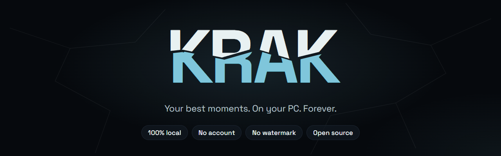
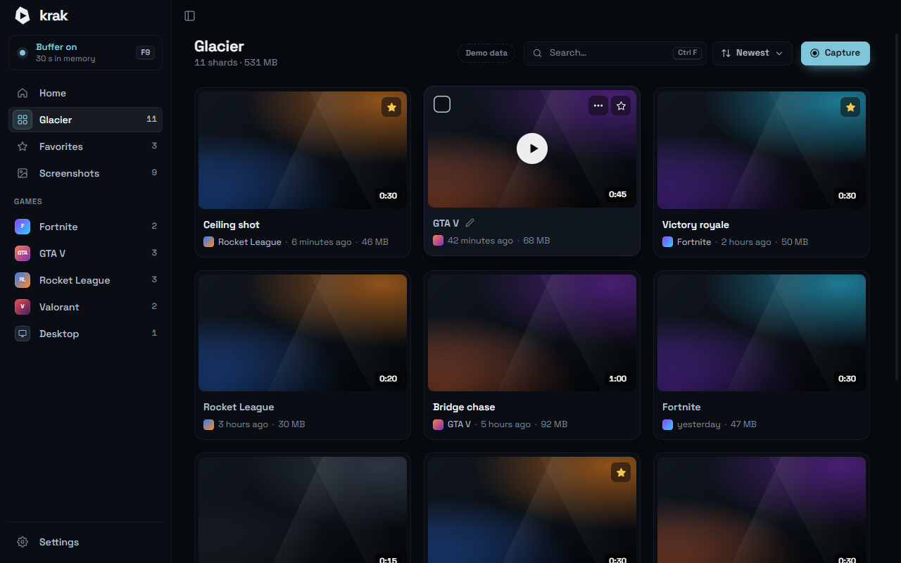

<p align="center">
  
</p>

<p align="center">
  <b>Free, open-source game clipping for Windows.</b><br>
  Hit a key, keep the moment: instant clips, a built-in editor and one-click Discord sharing.<br>
  100% local. No account, no cloud, no watermark.
</p>

<p align="center">
  
  
  
</p>

---

> **Krak is in early development.** There is no download yet: the first public beta is on its way.

<p align="center">
  
</p>

## Why Krak

- **Always ready.** The last seconds of gameplay are kept in memory. Press a key and they are saved instantly, no re-encoding.
- **Light.** Encoding runs on your graphics card (NVIDIA, AMD or Intel). The impact on your FPS should be invisible.
- **Yours.** Everything stays on your PC. Clips are plain MP4 files. Nothing is uploaded unless you decide to.
- **Anti-cheat safe.** Krak captures the screen like OBS or Discord do. It never injects into a game or reads its memory.
- **Simple.** Works out of the box. Advanced options are there, tucked away.

A clip is called a **shard**. Your library is the **Glacier**.

## Roadmap to the first beta

- [x] Krak identity, in 12 languages that follow Windows
- [x] App foundation: settings, global shortcuts, tray icon, launch at Windows startup, single instance
- [x] Glacier: shards sorted by game, favorites, search, rename, multi-select, built-in player, Recycle Bin
- [x] Always-on replay buffer, encoded natively with NVENC on NVIDIA (H.264, HEVC), with Standard, High and Premium presets
- [x] Continuous recording while the replay keeps working, safe from crashes
- [x] Screenshots, with their own page
- [x] Separate audio tracks: game and microphone, plus a mix that every player picks by default
- [x] Editor: trim bar, waveforms, volume of each audio track, remembered per clip
- [x] Export to a file, to the Glacier or to Discord under 10 MB, 50 MB or 500 MB, with an optional "by krak" badge
- [x] Discord Rich Presence
- [x] Installer and signed automatic updates
- [ ] Windows code signing (no SmartScreen warning)
- [ ] Native AMD and Intel encoders, separate Discord voice track, mouse cursor in clips, choice of the captured screen

**Later:** auto-clips (Rocket League first), vertical 9:16 format, slow motion, text and local subtitles, importing clips from ShadowPlay / OBS / Medal, community translations and detectors.

## Building from source

Requirements: Windows 10 or 11, [Node.js](https://nodejs.org) 20+, [Rust](https://rustup.rs) and the Visual Studio C++ build tools ([Tauri prerequisites](https://tauri.app/start/prerequisites/)).

```bash
npm install
npm run tauri dev     # run the app with hot reload
npm run tauri build   # build the installer
```

`tauri build` also signs the in-app update files, so it needs the update signing key: set `TAURI_SIGNING_PRIVATE_KEY` to the key (or its path) first. Forks generate their own pair with `npx tauri signer generate` and put the public key in `src-tauri/tauri.conf.json`.

Releases are built by GitHub Actions: push a tag such as `v0.2.0` (matching the version in `tauri.conf.json`) and a draft release is created with the installer and the signed update manifest.

### How capture works

The screen is read with DXGI Desktop Duplication, the same Windows API that OBS and Discord use, so nothing is injected into games. Frames are encoded on the graphics card and the last seconds are kept in memory: on NVIDIA through the driver's NVENC directly (H.264, HEVC and AV1 where the card has it, with B-frames, lookahead and adaptive quantization), on AMD and Intel through Media Foundation, with a software fallback. If the encoder cannot keep up (a heavy game, a high frame rate), it switches to lighter settings on the fly instead of dropping frames. Game sound comes from WASAPI loopback and the microphone from its own device, on separate tracks. Pressing the hotkey writes an MP4 straight from memory, without re-encoding. Continuous recording reuses the same encoded video and writes a fragmented MP4 as it goes, so a crash loses at most a second; screenshots are full-resolution PNGs of the same capture.

The quality presets and the measurements behind them (bitrates, tools, PSNR/SSIM, encoder speed) are documented in [`src-tauri/src/capture/quality.rs`](src-tauri/src/capture/quality.rs). The NVENC layer is a small C file compiled by `cargo` with the Visual Studio C++ tools, against NVIDIA's MIT-licensed `nvEncodeAPI.h` ([`src-tauri/native/nvenc`](src-tauri/native/nvenc)); the NVENC library itself ships with the NVIDIA driver and is loaded at run time, never redistributed.

Built with Rust, [Tauri](https://tauri.app) and [Svelte](https://svelte.dev).

### Translations

Krak speaks English, French, Spanish, Brazilian Portuguese, German, Italian, Polish, Turkish, Russian, Japanese, Korean and Simplified Chinese, and follows the language of Windows on first launch. English is the reference: every text lives in [`src/lib/locales/en.ts`](src/lib/locales/en.ts) first.

To add a language:

1. Copy `en.ts` to `src/lib/locales/<code>.ts` (`<code>` is the language's two-letter code, like `nl`) and translate the values. Keep the `{placeholders}` as they are.
2. Add the plural forms your language needs next to each text that has a `{count}`: `<key>.one`, `<key>.few`, `<key>.many`… as named by [`Intl.PluralRules`](https://developer.mozilla.org/docs/Web/JavaScript/Reference/Global_Objects/Intl/PluralRules) (the plain key is the "other" form).
3. Register it in [`src/lib/locales/index.ts`](src/lib/locales/index.ts), with its name written in that language.
4. Add the few texts the app shows outside its window (tray menu, file names) in [`src-tauri/src/i18n.rs`](src-tauri/src/i18n.rs), and the installer's language in `bundle.windows.nsis.languages` of [`tauri.conf.json`](src-tauri/tauri.conf.json).

`npm run check` fails if a translation misses a text. Until it is finished, type the file `Partial<Strings>` instead of `Translation`: the missing texts show in English.

## License

Krak is free software, released under the [GNU GPL v3.0](LICENSE). You can use it, study it, change it and share it. If you distribute a modified version, it must stay free and open source under the same license, with its source code available.

The **Krak** and **Kryo Studio** names and logos are not covered by this license. Forks must use their own name and logo: see [TRADEMARKS.md](TRADEMARKS.md) and [NOTICE](NOTICE).

Copyright © 2026 Kryo Studio.
